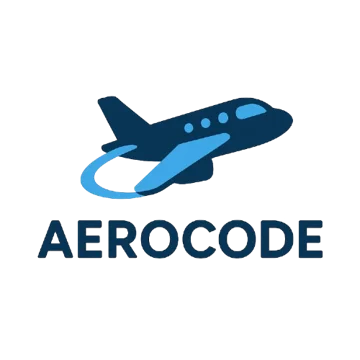
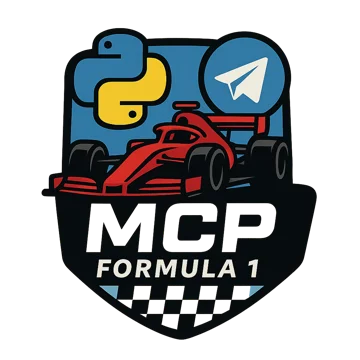

.# Portfólio · Vivian Santos

**Análise e Desenvolvimento de Sistemas · FATEC São José dos Campos · 5º semestre**


Fui enfermeira antes de programar. Na enfermagem aprendi a trabalhar sob pressão, a me comunicar com clareza e a cuidar dos detalhes, e hoje levo isso para o desenvolvimento de software: entender bem o problema antes de propor a solução.

Neste portfólio reúno os projetos que desenvolvi durante o curso, do 1º ao 5º semestre. A maioria foi feita em equipe, com Scrum e validação com clientes reais, pela metodologia de **Aprendizagem por Projeto Integrado (API)**. Desde o 3º semestre faço parte da **[Equipe Sul](https://github.com/Equipe-SUL)**.


📧 [vivian.stoliveira@gmail.com](mailto:vivian.stoliveira@gmail.com) · 💼 [LinkedIn](https://www.linkedin.com/in/vivianstoliveira/) · 💻 [GitHub](https://github.com/vivianSantos0101)

<br clear="right">

---

## Sumário

| Semestre | Projeto | Tipo | Principais tecnologias |
|:---:|---|---|---|
| 5º | [Stentio](#stentio) | API · Equipe Sul | Java, Spring Boot, PostgreSQL, RabbitMQ, Docker |
| 4º | [Blueprint](#blueprint) | API · Equipe Sul | React, Django, PostgreSQL, Ollama |
| 3º | [EntreNova Flix](#entrenova-flix) | API · Equipe Sul | React, Node.js, Supabase, Gemini/OpenAI |
| 3º | [Aerocode](#aerocode) | Técnicas de Programação | TypeScript, React, Express, Prisma |
| 3º | [MCP Formula 1](#mcp-formula-1) | Interação Humano-Computador | Python, MCP, Ollama, Whisper |
| 3º | [Portfólio em Express](#portfólio-em-express) | Projeto pessoal | Node.js, Express, EJS, MySQL |
| 2º | [BotEcho](#botecho) | API · Equipe Echo | Java, Ollama |
| 2º | [Gerenciador de Cursos](#gerenciador-de-cursos) | Linguagem de Programação | Java, Swing, MySQL |
| 1º | [EasyScrum](#easyscrum) | API · Equipe Echo | Python, Flask |

Também neste documento: [Competências](#competências) · [Formação e certificações](#formação-e-certificações) · [Sobre este repositório](#sobre-este-repositório)

---

## 5º semestre · ago – dez 2026

### Stentio


**API 5º semestre · Equipe Sul · em desenvolvimento** · [Repositório](https://github.com/Equipe-SUL/Stentio)

**Desafio.** Agências de tradução controlam o trabalho em planilhas, e-mails e conversas soltas: o orçamento é montado à mão, as etapas de tradução, revisão e formatação são distribuídas por mensagem e não existe registro confiável de quem fez o quê, em que prazo e a que custo.

**Solução.** Um sistema web que centraliza a operação da agência: cadastros, pedido do cliente, orçamento com aprovação por link, ordem de serviço dividida em etapas, alocação de profissionais e fechamento financeiro. A arquitetura é de microsserviços (autenticação, núcleo de negócio, e-mail, importação e chatbot) orquestrados com Docker Compose.

**Minha contribuição.** Atuei como desenvolvedora backend no serviço principal (Java + Spring Boot), com mais de 80 commits:
- Fluxo da **ordem de serviço**: entidade de etapas, modelos de workflow, montagem da sequência e bloqueios de alteração
- **Alocação de profissionais** às etapas, com regras de elegibilidade e log de auditoria
- **Portal do profissional**: auto-cadastro, verificação, convite por e-mail, aceite, recusa e entrega dos arquivos
- **Revisão e entrega final** da OS, com envio do documento ao cliente por e-mail
- **Certificação por par de idiomas**, com fila de análise, aprovação e rejeição
- CRUD de recursos e de tabela de preços, perfis de acesso com JWT e **testes automatizados**

**O que aprendi.** Desenvolver em uma arquitetura de microsserviços, mensageria com RabbitMQ, modelar regras de negócio complexas em Spring Boot e escrever testes para garantir que uma mudança não quebre o restante do fluxo.

---

## 4º semestre · mar – jun 2026

### Blueprint


**API 4º semestre · Equipe Sul · cliente: Exército Brasileiro** · [Repositório](https://github.com/Equipe-SUL/Blueprint) · [Vídeo de demonstração](https://www.youtube.com/watch?v=aQZifRPN6wY)

**Desafio.** Para licitar uma obra, os engenheiros do Exército produzem à mão memoriais de cálculo, especificações e orçamentos seguindo as normas da ABNT, desde a leitura dos arquivos CAD até a formatação final. São horas de trabalho especializado por obra.

**Solução.** Uma aplicação web que recebe os arquivos da obra (CAD, CSV ou Excel), calcula os quantitativos de materiais em Python, confere os itens com a tabela SINAPI e usa IA local (Ollama) para gerar os documentos técnicos padronizados, com prévia e exportação em PDF e DOCX.

**Minha contribuição.** Atuei como desenvolvedora na equipe ao longo das três sprints.

**O que aprendi.** Trabalhar com um cliente de um domínio técnico que eu não conhecia (engenharia e orçamento de obras), backend em Django e uso de IA para gerar documentos que precisam seguir normas rígidas.

---

## 3º semestre · ago – dez 2025

### EntreNova Flix


**API 3º semestre · Equipe Sul · cliente: Entrenova** · [Repositório](https://github.com/Equipe-SUL/EntreNova-Flix)

**Desafio.** A Entrenova queria validar produtos de treinamento corporativo e, para isso, precisava entender as necessidades reais das empresas por meio de entrevistas estruturadas.

**Solução.** Um sistema que aplica um diagnóstico às empresas (formulário + chatbot) e gera, com IA (Gemini e OpenAI), relatórios personalizados e uma trilha de treinamento sugerida, enviada por e-mail. Um painel com gráficos reúne os dados para a Entrenova.

**Minha contribuição.** Atuei como desenvolvedora na equipe.

**O que aprendi.** Integrar modelos de IA em um produto real, usar o Supabase como banco e trabalhar com React e TypeScript em um projeto em equipe.

<br clear="right">

### Aerocode



**Técnicas de Programação · AV1, AV2 e AV3 · individual**

Sistema de gestão da produção de aeronaves (aeronaves, peças, etapas, testes e funcionários) que construí em três avaliações, cada uma subindo um nível em cima da anterior:

| Avaliação | O que construí | Tecnologias | Código |
|:---:|---|---|---|
| **AV1** | Aplicação de linha de comando com as regras de negócio modeladas em classes e geração de relatórios | TypeScript, POO | [AV1](https://github.com/vivianSantos0101/AV1) |
| **AV2** | Interface web para o mesmo sistema, com rotas e telas por perfil | React, TypeScript, Vite | [AV2](https://github.com/vivianSantos0101/AV2) |
| **AV3** | API REST com banco de dados, login com JWT, senhas com bcrypt, três perfis de acesso e testes de carga dos endpoints | Express, Prisma, MariaDB, JWT, Zod | [AV3](https://github.com/vivianSantos0101/AV3) |

**O que aprendi.** Como um mesmo sistema evolui: começar pela modelagem orientada a objetos, depois separar interface e regra de negócio e, por fim, levar tudo para uma arquitetura cliente-servidor com autenticação e banco de dados.

<br clear="right">

### MCP Formula 1



**Interação Humano-Computador (IHC) · código privado, disponível sob pedido**

**Desafio.** Permitir que qualquer pessoa consulte dados da Fórmula 1 conversando naturalmente, sem saber SQL nem usar uma interface complicada.

**Solução.** Um bot do Telegram que aceita perguntas por **texto ou áudio**. O áudio é transcrito com Whisper, uma IA que roda localmente (Qwen 2.5 via Ollama + LlamaIndex) transforma a pergunta em uma consulta estruturada e um **servidor MCP** (FastMCP) executa essa consulta no banco SQLite de equipes e campeões. A resposta volta em linguagem natural. Operações de escrita no banco são liberadas só para administradores, identificados pelo ID do Telegram.

**O que aprendi.** Pensar a interação do ponto de vista do usuário (voz e linguagem natural como interface), usar o Model Context Protocol para dar ferramentas a uma IA e limitar o que a IA pode fazer no banco por questões de segurança.

<br clear="right">

### Portfólio em Express

**Projeto pessoal · individual** · [Repositório](https://github.com/vivianSantos0101/portfolioExpress)

Primeira versão do meu portfólio, renderizada no servidor com Express e EJS. Tem painel de administrador com login para editar projetos, habilidades e idiomas guardados em MySQL e formulário de propostas que envia e-mail com Nodemailer.

**O que aprendi.** Rotas e middlewares no Express, sessões e autenticação, CRUD com MySQL e envio de e-mails pelo servidor.

---

## 2º semestre · fev – jun 2025

### BotEcho


**API 2º semestre · Equipe Echo** · [Repositório](https://github.com/EquipeEcho/botEcho)

**Desafio.** Ajudar desenvolvedores iniciantes a melhorar seu código e a entender trechos que não conhecem.

**Solução.** Uma IDE desktop em Java com IA rodando localmente (Ollama) que analisa, explica e otimiza código Python, executa o código, gera documentação automaticamente, cria gráficos com Matplotlib e se integra ao GitHub.

**Minha contribuição.** Fiz parte do time de desenvolvimento (Scrum Team).

**O que aprendi.** Desenvolvimento desktop em Java, integração com modelos de linguagem locais e o primeiro contato com Scrum ao longo de três sprints com entregas reais.

<br clear="right">

### Gerenciador de Cursos


**Linguagem de Programação · 2ª avaliação · individual** · [Repositório](https://github.com/vivianSantos0101/GerenciadorCurso)

Sistema desktop para uma universidade cadastrar cursos e alunos e emitir relatórios. Interface em Java Swing, persistência em MySQL usando o padrão **DAO** e uma fábrica de conexões, com manual do usuário e script SQL documentados.

**O que aprendi.** Organizar um projeto Java em camadas (modelo, acesso a dados e interface), JDBC e modelagem de banco relacional.

<br clear="right">

---

## 1º semestre · ago – dez 2024

### EasyScrum


**API 1º semestre · Equipe Echo · Product Owner** · [Repositório](https://github.com/EquipeEcho/EasyScrum) · [Vídeo de demonstração](https://youtu.be/RhitfLJMUBE)

**Desafio.** Explicar a metodologia Scrum de forma simples para pessoas sem experiência em métodos ágeis.

**Solução.** Um site educativo com textos, imagens e áudios produzidos pela própria equipe, desenvolvido em Python com Flask e apresentado na Feira de Soluções da FATEC.

**Minha contribuição.** Fui a **Product Owner** do time: organizei e priorizei o backlog, escrevi as histórias de usuário e validei as entregas de cada sprint.

**O que aprendi.** Os papéis e cerimônias do Scrum na prática, comunicação entre equipe e cliente e os fundamentos de desenvolvimento web.

<br clear="right">

---

## Competências

**Linguagens e frameworks**


**Bancos de dados e infraestrutura**


**Inteligência artificial:** LLMs locais com Ollama, APIs da OpenAI e do Gemini, Model Context Protocol (MCP), Whisper

**Metodologias:** Scrum (atuei como Product Owner e como desenvolvedora), histórias de usuário, Jira

**Interpessoais:** comunicação clara, trabalho em equipe, resolução de problemas, adaptabilidade, gestão do tempo, criatividade

**Idiomas:** português (nativo), inglês (fluente), espanhol (fluente)

---

## Formação e certificações

**Análise e Desenvolvimento de Sistemas** · FATEC São José dos Campos · 2024 – em andamento (5º semestre)

| Certificação | Instituição |
|---|---|
| NDG Linux | Cisco Networking Academy |
| IT Essentials | Cisco Networking Academy |
| Introdução à Programação Orientada a Objetos | Fundação Bradesco |
| Análise de Dados no Power BI | Fundação Bradesco |

---

## Sobre este repositório

Além deste README, o repositório traz a **versão em site** do portfólio, feita com **React + TypeScript + Vite**: linha do tempo de projetos por semestre, formulário de contato com validação e envio por EmailJS, layout responsivo e cuidados de acessibilidade. Todo o conteúdo do site fica em um único arquivo, [`src/data/portfolio.ts`](src/data/portfolio.ts).

<details>
<summary><strong>Como rodar o site localmente</strong></summary>

<br>

Pré-requisito: [Node.js](https://nodejs.org/) 20 ou mais recente.

```bash
git clone https://github.com/vivianSantos0101/portfolioADS.git
cd portfolioADS
npm install
npm run dev
```

Abra `http://localhost:5173`.

Para o formulário de contato enviar e-mails, copie `.env.example` para `.env` e preencha as chaves do [EmailJS](https://www.emailjs.com/). Sem elas o site funciona normalmente e o formulário mostra o e-mail para contato direto.

O deploy é feito gratuitamente na [Vercel](https://vercel.com/), que publica uma nova versão a cada `git push` na branch `main`.

</details>
